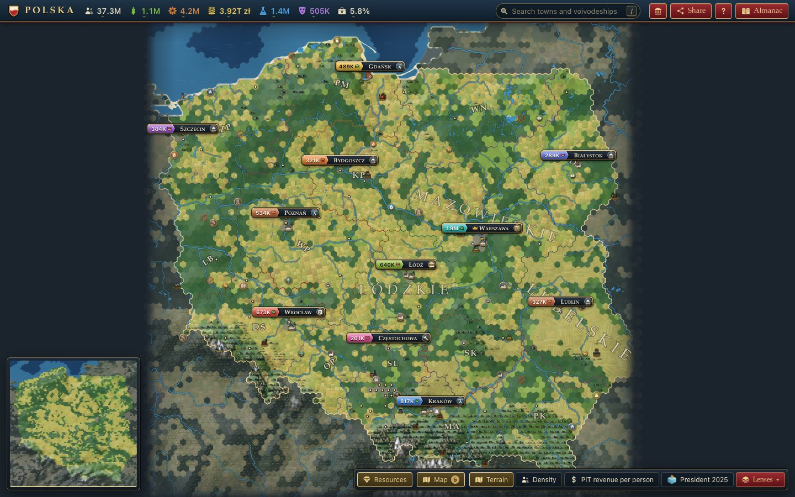

# pol-civ: Poland as a strategy map, built from real data

**Live: [softonsofa.com/pol-civ](https://softonsofa.com/pol-civ/)**



A visualizer (not a game) that draws the **real** Poland like a turn-based strategy map. Hex terrain comes from elevation and land-cover data. Towns carry yield banners built from GDP and jobs. Resources are real power plants, mines and offshore wind farms. Motorways, railways, ports, airports, garrisons and wonders sit on the tiles. There are lenses for 2,479 gminas, a City View for 204 towns, and a council of advisors named after the offices of the old Commonwealth. Every number traces back to a public source in the in-app **Almanac**.

pol-civ is a fork of [usaciv](https://karpathy.ai/usaciv) by Andrej Karpathy (MIT). The engine, the art system and the architecture are his. This fork replaces every US dataset with Polish and European public data and retunes the map, the towns and the text for Poland.

## What's in it

- **The map.** About 4,800 land hexes of 5 km: the Baltic coast with the Hel and Vistula spits, the Masurian and Pomeranian lake districts, the Vistula and Oder river systems, the Tatra, Sudety and Bieszczady with relief and snow, forests, wetlands and the farmland of the plains. Neighbours sit under fog.
- **Yields.** Food, Production, Gold, Science and Culture. Gold is GDP. The others are employment by PKD section.
- **Towns.** 1,026 towns with their population on 31 December 2025. 204 of them open a City View with citizens (age, education, sector of work), districts from employment location quotients, and badges such as Port city, Copper town or University town. Metros are Eurostat functional urban areas.
- **Lenses.** 28 lenses by gmina, powiat or voivodeship: density, age, growth, migration, Ukrainian residents with PESEL UKR, PIT revenue per person, wages, unemployment, education, health, faith and Mass attendance, the 2025 presidential vote and turnout, the 2023 Sejm vote, air quality, the 2024 flood area, land cover.
- **Layers.** Motorways, expressways and main railways (OpenStreetMap), seaports by tonnage, airports by passengers, power plants by fuel, mines, Baltic offshore wind farms, garrisons and allied sites, freight routes, and wonders chosen by published rules (UNESCO sites, the most visited national parks, the largest research universities, landmarks). Memorial sites are shown as memorials.
- **Advisors.** Podskarbi (economy), Ochmistrz (prosperity), Gdańsk Merchant (commerce), Żupnik (energy and resources), Lustrator (people), Rektor (knowledge), Kustosz (culture), Geometra (land), Hetman (military) and the Kartograf, an explorer that turns any column into a table and a scatter plot linked to the map.

## Quick start

You need [uv](https://docs.astral.sh/uv/) (Python 3.11+). Nothing else.

```bash
uv run python -m pipeline serve        # http://127.0.0.1:8765
```

The built data (`web/data/`) is included. `web/` is a static site: plain ES modules and Canvas 2D, no framework, no build step.

To rebuild the data from the publishers:

```bash
uv run python -m pipeline all          # download (cached), process, build web/data, check
uv run python -m unittest discover -s tests
```

The pipeline is standard-library Python. Sources live in `pipeline/sources/` (one module per publisher dataset), builders in `pipeline/build/`, and the shape of every data file in `docs/DATA_CONTRACTS.md`. `docs/reference/sources-*.md` lists each source with its URL, vintage, licence and caveats.

## Data sources

33 public sources, none needing an API key. Main publishers:

| Publisher | Used for |
|---|---|
| Statistics Poland (GUS): BDL, population tables, NSP 2021, labour and income tables | Population, growth, age, migration, wages, unemployment, jobs by section, education, health, housing, tourism, towns, TERYT codes |
| Ministry of Finance | PIT revenue per person by gmina |
| Eurostat and GISCO | Gmina boundaries (LAU), functional urban areas, regional GDP, airports, freight, network lengths |
| PKW (National Electoral Commission) | Presidential 2025 and Sejm 2023 results by gmina |
| GIOŚ (Chief Inspectorate of Environmental Protection) | Air quality by station, 2025 |
| URE (Energy Regulatory Office), PSE, operators | Power plants, renewables by powiat |
| UNESCO, National Heritage Board (NID) | World Heritage sites, Pomniki Historii |
| MON, NATO | Garrisons, allied sites, strength, the 2026 defence budget |
| NOAA ETOPO 2022, ESA WorldCover 2021, Copernicus land cover, HydroRIVERS, Natural Earth | Relief, land cover, forests, rivers, lakes, neighbours |
| OpenStreetMap contributors | Motorways, railways, town positions, plant positions |
| ISKK | Mass attendance by diocese |

## Reading the map honestly

- **Yields are names given to real figures.** Gold is GDP. The other yields are job counts by section.
- **Positions are schematic.** Each hex is about 65 km² and shows the place it covers. District plaques show what a town specialises in, not where in the town those jobs are.
- **Missing data stays missing.** It is null, never 0. Lenses say at which level (gmina, powiat or voivodeship) each figure exists.
- **Selections are rules.** Wonders, garrisons and trade routes are picked by rules published in the data files and shown in the app.

## Licence and credits

The code is MIT-licensed (see [LICENSE](LICENSE)): the original usaciv code by Andrej Karpathy and this fork's changes. The licence covers the code only. The data belong to their publishers and are used under their terms: Polish public statistics and registers are free to reuse with attribution; Eurostat and Copernicus data under their reuse policies; ESA WorldCover and HydroSHEDS under CC BY 4.0; OpenStreetMap data © OpenStreetMap contributors under the ODbL, so the derived road, rail and position data in `web/data/` stay under the ODbL.

The look is inspired by turn-based 4X strategy games. Every glyph, icon and texture is original and drawn in code. This project is not affiliated with or endorsed by any game publisher.
